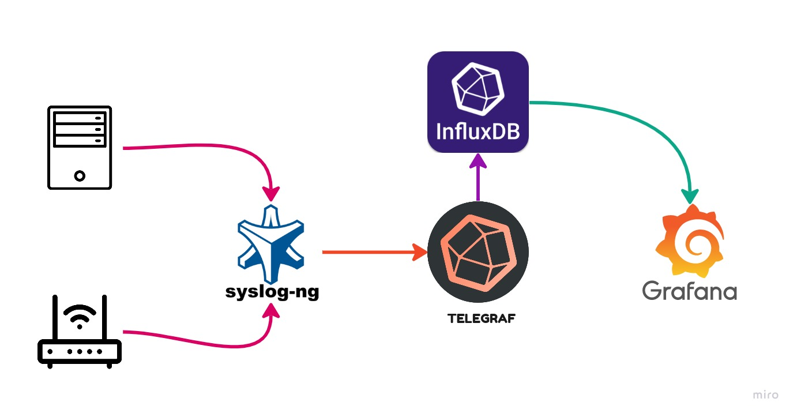
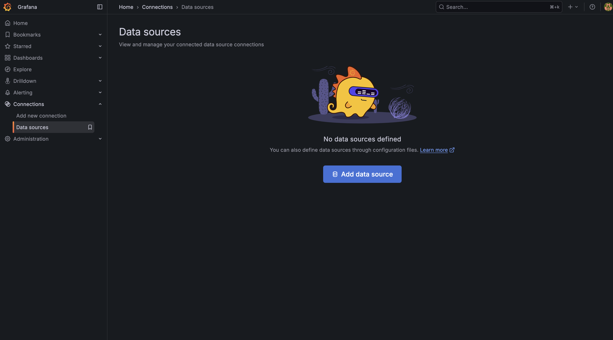
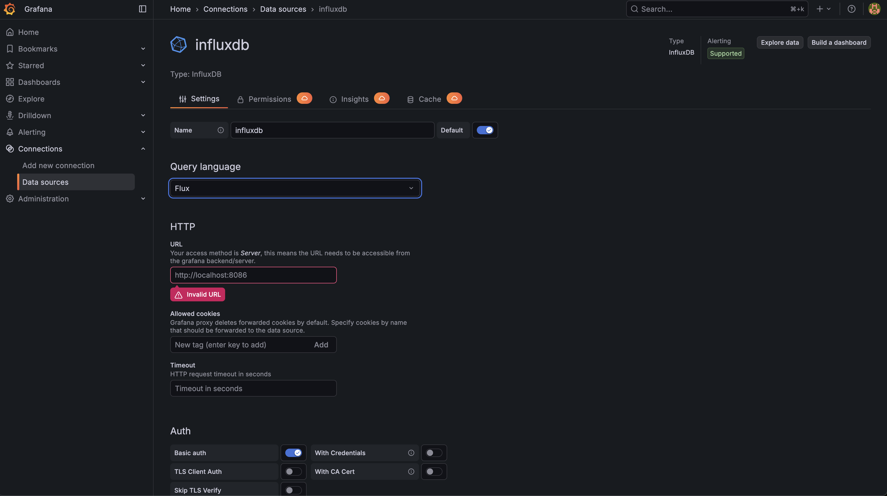
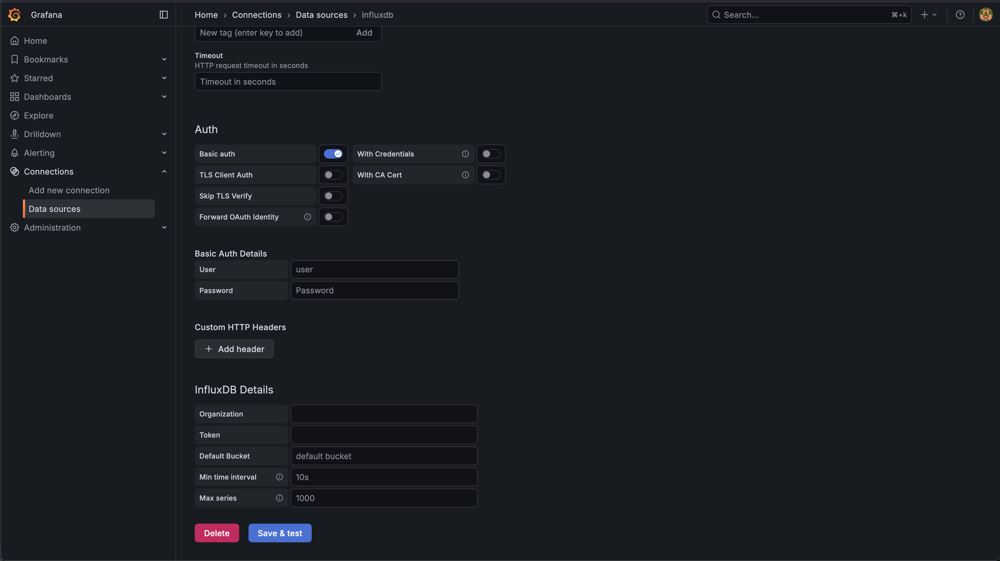

# 📊 Servidor Syslog Grafana-InfluxDB 2.x 🚀

## Una guía completa para configurar una solución Syslog escalable 📝

Esta guía proporciona instrucciones detalladas para implementar un servidor syslog robusto y escalable utilizando Grafana, InfluxDB 2.x, Telegraf y Syslog-ng. Ya sea para uso doméstico o entornos empresariales, esta solución ofrece una recopilación, almacenamiento y visualización de registros eficiente. 🏠🏢

# ¿Cómo funciona? ⚙️

Inicialmente, los registros UDP se dirigen al contenedor Syslog-ng. Este contenedor luego reenvía los registros a Telegraf, que se encarga de analizar y estructurar los datos. Los datos procesados se envían a InfluxDB para su almacenamiento. Finalmente, Grafana se utiliza para visualizar y consultar estos registros, proporcionando paneles de control informativos.

### ¿Por qué Syslog-ng? 🤔

El complemento de entrada syslog de Telegraf tiene limitaciones respecto a los formatos syslog UDP. Según su [documentación oficial](https://github.com/influxdata/telegraf/blob/master/plugins/inputs/syslog/README.md):

> Por defecto se utiliza RFC5424. RFC3164 solo admite transporte UDP (sin soporte de transmisión)

Para superar esto, Syslog-ng actúa como intermediario. Recibe los registros y los formatea en una estructura que Telegraf puede aceptar sin problema.

*(**Nota**: Si tus registros ya se están enviando desde `rsyslog` o `syslog-ng` en un formato compatible, puedes omitir el contenedor dedicado Syslog-ng y enviar los datos directamente a Telegraf. Esto requiere modificar el archivo `docker-compose.yml` para exponer el puerto **TCP** para Telegraf.)*

# Así es como funciona:


# Guía de instalación 🚀

Para comenzar, asegúrate de tener [Docker](https://docs.docker.com/engine/install/) y [Docker Compose](https://docs.docker.com/compose/install/) instalados en tu sistema operativo.

1.  **Clonar el repositorio**:
    ```bash
    git clone https://github.com/AAm-kun/Grafana-Influxdb_2.x-Syslog-server.git
    ```

2.  **Navegar y configurar**:
    Cambia al directorio clonado y modifica el archivo `docker-compose.yml` para ajustar los parámetros según tus requisitos.

3.  **Iniciar el stack**:
    Abre tu terminal dentro del directorio del proyecto y ejecuta el siguiente comando:
    ```bash
    sudo docker compose up -d
    ```
    *(Este comando es compatible tanto con Docker Compose V1 como V2.)*

### Configuración de Grafana 📊

Una vez que todos los contenedores se estén ejecutando correctamente, accede a la interfaz web de Grafana a través de tu navegador en [http://localhost:3000](http://localhost:3000).

1.  **Inicio de sesión inicial**:
    *   Credenciales predeterminadas: `admin`/`admin`.
    *   **Importante**: Cambia estas credenciales predeterminadas inmediatamente por razones de seguridad.

2.  **Agregar fuente de datos de InfluxDB**:
    *   Navega a `Connections` -> `Add new connection` -> `InfluxDB`.
    *   Configura los campos según tu archivo `docker-compose.yml`.
    *   Asegúrate de seleccionar `flux` como **Query Language**.
    *   Proporciona el token de InfluxDB desde tu archivo `docker-compose.yml`.
    *   Tu página de configuración debería parecerse a la siguiente (las credenciales pueden variar):
        
        
        
    *   Haz clic en `Save & Test`. Una notificación de éxito confirmará que tu fuente de datos está funcionando correctamente.

3.  **Importar panel de Syslog**:
    *   Ve a `Dashboards` -> `New` -> `Import`.
    *   Ingresa el ID del panel de Grafana `[18679](https://grafana.com/grafana/dashboards/18679-syslog/)` y haz clic en `Load`.
    *   Selecciona la fuente de datos de InfluxDB configurada y haz clic en `Import`.
    *   ¡Ahora deberías ver tus datos de syslog visualizados en el panel de control!

### Paso final: Configurar tus dispositivos 💻

Finalmente, configura tus servidores o enrutadores para que envíen mensajes syslog a la dirección IP y puerto de tu servidor syslog recién configurado.
