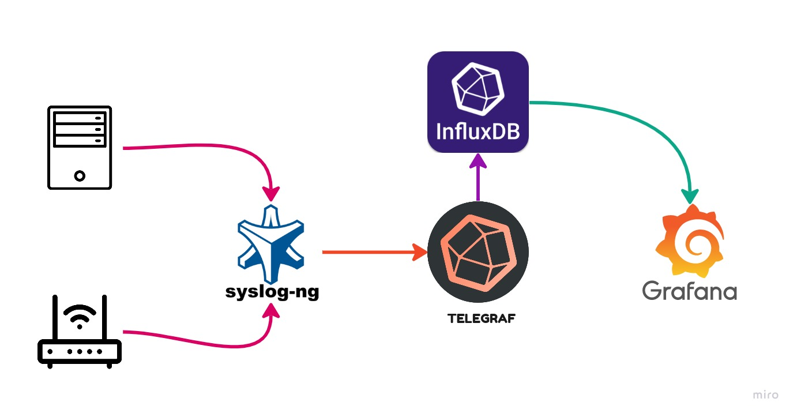
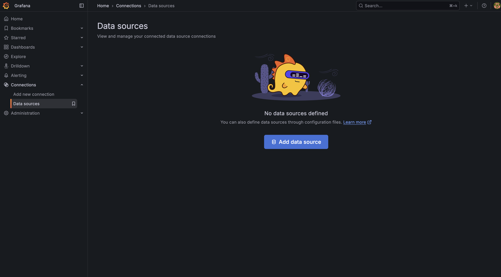
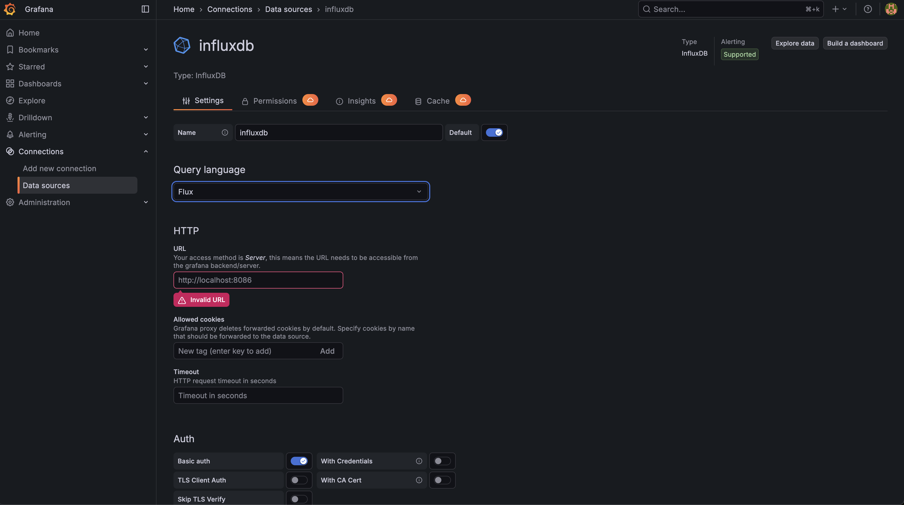
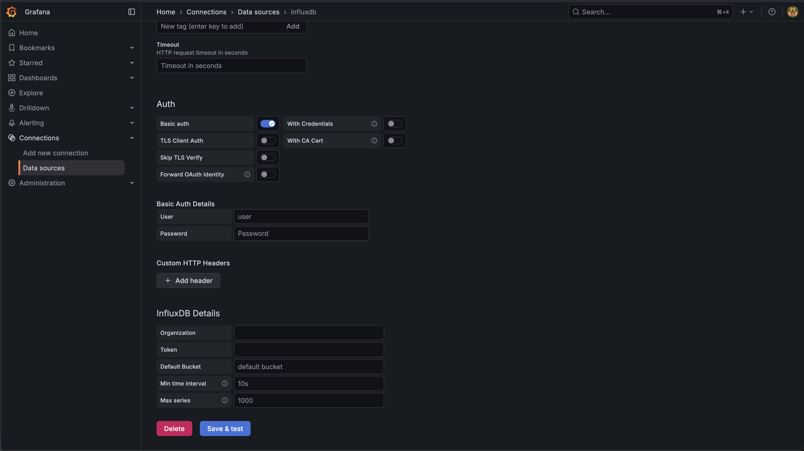

# Grafana + InfluxDB 2.x Syslog Server

A Docker Compose setup for collecting syslog messages with Syslog-ng and Telegraf, storing them in InfluxDB 2.x, and visualizing them in Grafana.

## How it works

1. Syslog-ng receives UDP syslog messages on port `514` of the host.
2. Syslog-ng forwards messages to Telegraf over TCP.
3. Telegraf parses the messages and writes them to the InfluxDB 2.x `syslog` bucket.
4. Grafana queries InfluxDB to display the data.

Telegraf's syslog input has limitations with some UDP syslog formats. Syslog-ng serves as an intermediary, receiving UDP messages and forwarding them in a format Telegraf can process. If your devices already send a compatible format to Telegraf, you may be able to omit Syslog-ng.



## Requirements

- Docker Engine
- Docker Compose

## Install and start

1. Clone this repository and enter the directory:

   ```bash
   git clone https://github.com/AAm-kun/Grafana-Syslog-server.git
   cd Grafana-Syslog-server
   ```

2. Review `docker-compose.yml` and `telegraf/telegraf.conf` before starting. Change the example InfluxDB username, password, and admin token to secure values. Keep the token, organization, and bucket settings consistent between the two files. Do not expose the example credentials to an untrusted network.

3. Start the services:

   ```bash
   docker compose up -d
   ```

## Configure Grafana

Open [http://localhost:3000](http://localhost:3000) and sign in with the default Grafana credentials, `admin` / `admin`. Change the password when prompted.

### Add InfluxDB as a data source

In Grafana, go to **Connections → Add new connection → InfluxDB** and configure:

- **Query language:** Flux
- **URL:** `http://influxdb:8086`
- **Organization:** `router` (or the organization configured in `docker-compose.yml`)
- **Default bucket:** `syslog` (or the bucket configured in `docker-compose.yml`)
- **Token:** the InfluxDB token configured in `docker-compose.yml` and `telegraf/telegraf.conf`

Save and test the data source. The screenshots below show an example configuration; values may differ if you changed the Compose settings.





### Import the syslog dashboard

1. In Grafana, go to **Dashboards → New → Import**.
2. Enter dashboard ID [18679 (Syslog)](https://grafana.com/grafana/dashboards/18679-syslog/) and select **Load**.
3. Select the InfluxDB data source you configured and import the dashboard.

## Configure your devices

Configure your servers, routers, or other devices to send syslog messages to the Docker host's IP address over UDP port `514`. The Compose configuration maps that host port to Syslog-ng's UDP listener.
